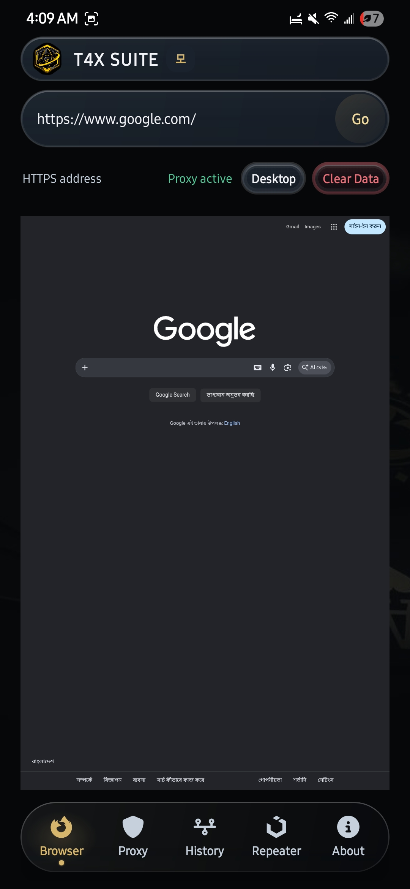
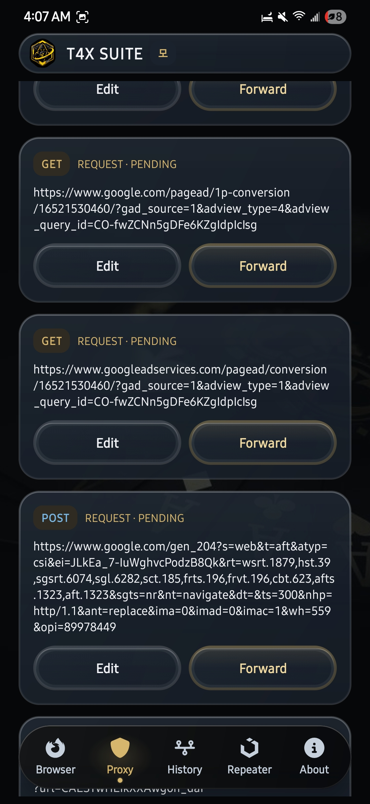
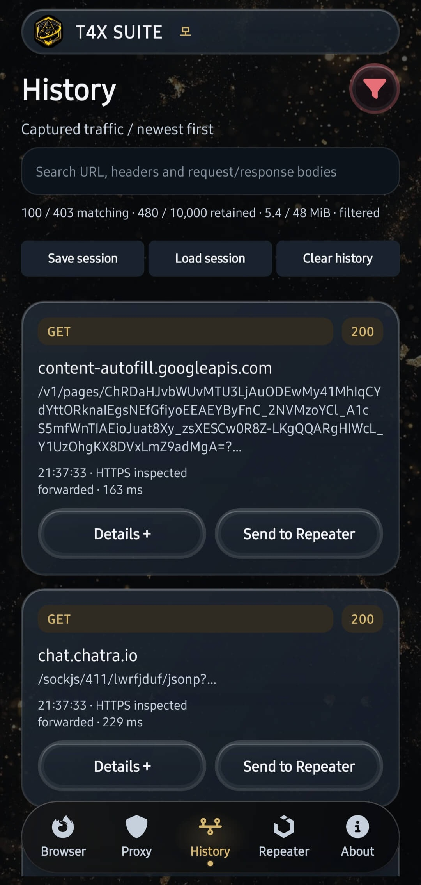
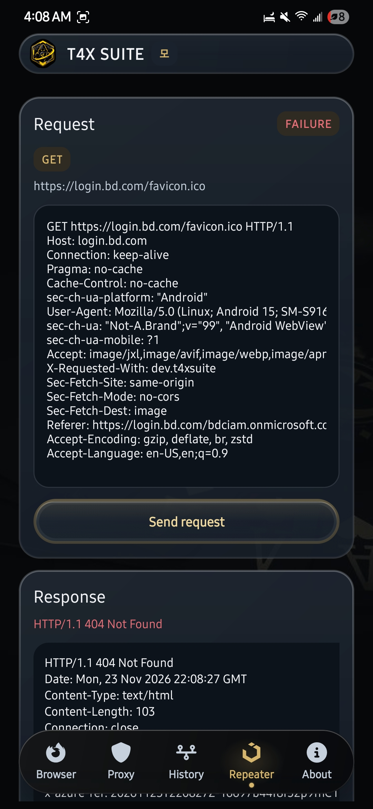
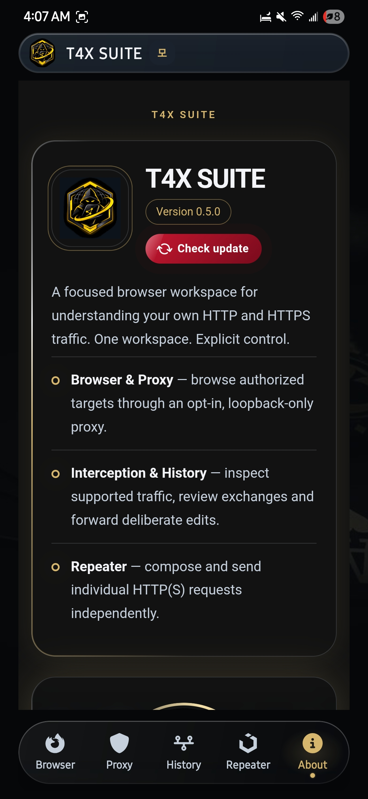

# T4xSuite

**Open-Source, Non-Root Android HTTP/HTTPS Intercepting Proxy, HTTP Repeater, and Burp Suite Mobile Alternative**

[-080A0E?style=for-the-badge&logo=android&logoColor=D6B56D)](https://github.com/tausifzaman/T4xSuite/releases/latest)

---

## Overview

**T4xSuite** (in-app header: **T4X SUITE**) is a free, **open-source**, **non-root** native Android web security testing suite built as a lightweight **Burp Suite mobile alternative** for bug bounty hunters, penetration testers, security researchers, and Android developers.

It combines an isolated testing browser, an opt-in loopback HTTP/HTTPS MITM proxy, inline request/response interception, live exchange history, and a standalone raw HTTP/1.1 Repeater directly on your Android device—with **zero root required**, **zero VPN service**, **zero trackers**, and **no desktop PC**.

---

## Download, Installation & Verification

1. Visit the **[GitHub Releases](https://github.com/tausifzaman/T4xSuite/releases/latest)** page.
2. Download the latest `.apk` file under **Assets**.
3. Open the APK on your Android device (Android 10 / API 29 or newer) and tap **Install** (enable *Install from unknown sources* if prompted).

You can also check for new releases anytime directly inside the app via **About > Check update**.

## Screenshots

| Browser & Smart Search | Proxy & User CA Lab |
| :---: | :---: |
|  |  |

| Traffic History | Raw HTTP Repeater |
| :---: | :---: |
|  |  |

| About & Update Checker |
| :---: |
|  |

---

### Security, Privacy & VirusTotal Audit

T4xSuite is engineered with strict local-only boundaries, zero telemetry, and a minimal `AndroidManifest.xml`:

| Audit Check | Status / Details |
| :--- | :--- |
| **VirusTotal Scan** | **[0 Detections — 100% Clean](https://www.virustotal.com/gui/file/3ce448be31018026bb3d3eb421cb73fd79bb26c53451c97c380c61c2e2b86cf9?nocache=1)** |
| **APK SHA-256** | `3ce448be31018026bb3d3eb421cb73fd79bb26c53451c97c380c61c2e2b86cf9` |
| **Root Requirement** | **Non-Root** (works out of the box on stock, locked-bootloader Android devices) |
| **Trackers & Analytics** | **0 Trackers** (no Firebase, Google Analytics, Crashlytics, AdMob, or telemetry SDKs) |
| **Granted Permissions** | `android.permission.INTERNET` only |
| **Not Requested / Never Used** | No Storage (`READ/WRITE_EXTERNAL_STORAGE`), No VPN (`BIND_VPN_SERVICE`), No Accessibility Service, No Device Admin, No Location, Camera, Contacts, or Background Foreground Service |
| **Cloud Backup** | Disabled (`android:allowBackup="false"`) so sensitive session keys and CA material never upload to cloud backups |

---

## Key Features

### 1. Isolated Testing Browser
- **Smart URL & Google Search Bar:** Automatically distinguishes full `http://` and `https://` links, bare domains or `localhost` / IPv4 hosts (auto-prepending `https://` or loopback `http://`), and keyword searches (routed to Google Search).
- **Mobile & Desktop Mode Switch:** Toggle between standard Mobile mode and Desktop (`Linux x86_64`) mode in one tap during an active session.
- **Zero-Bloat Cache & Data Control:** Uses `LOAD_NO_CACHE` to prevent unnecessary disk cache accumulation and provides a confirmed **Clear Data** button to wipe WebView cache, cookies, `WebStorage`, form autocomplete, and navigation history.

### 2. Non-Root Loopback HTTP/HTTPS Intercepting Proxy
- **Zero-Root, Zero-VPN Architecture:** Binds strictly to `127.0.0.1` on an ephemeral port and routes only T4xSuite's built-in browser—no system-wide VPN profile, root privileges, or Magisk modules needed.
- **Opt-In HTTPS Inspection & Live CA Trust Check:** Generates an RSA-2048 local Certificate Authority encrypted at rest via Android Keystore AES-GCM, exports the public `.crt` certificate to `Download/T4X-SUITE` via MediaStore (requiring zero storage permissions), and automatically checks Android's User CA trust store to confirm installation status.
- **Inline Request & Response Interception:** Pause HTTP and inspected HTTPS traffic inline, modify raw headers or payloads with automatic `Content-Length` recalculation, or forward original bytes untouched.

### 3. Standalone Raw HTTP/1.1 Repeater
- **Independent Replay Engine:** Sends raw HTTP/1.1 requests directly to target servers over fresh sockets with strict TLS certificate and hostname validation—working even when the proxy is stopped.
- **Complete Framing Support:** Handles `Content-Length`, chunked transfer encoding, `HEAD`/no-body responses, request cancellation, and up to 2 MiB raw capture (64 KiB selectable monospace preview).

### 4. Live Traffic History & HAR Audit
- **In-Memory Exchange Inspector:** Logs up to 500 newest-first exchanges with expandable request/response details, sensitive header masking (`Set-Cookie`, `WWW-Authenticate`), escaped response previews, and one-tap **Send to Repeater** replay.
- **Offline HAR Review:** Built-in HTTP Archive (`.har`) viewer for inspecting recorded traffic and passive security header/cookie observations.

---

## HTTPS Interception Setup Guide

1. Open **T4xSuite** and go to the **Proxy** tab.
2. Tap **Generate CA** (or **Export CA certificate**) to save `T4X-SUITE-CA.crt` into `Download/T4X-SUITE`.
3. Open your Android **Settings > Security & privacy > More security settings > Encryption & credentials > Install a certificate > CA certificate** (menu wording varies by device) and select `T4X-SUITE-CA.crt`.
4. Return to **T4xSuite**—the status will automatically update to **CA stored & installed in Android**.
5. Tap **Start proxy**, enable **HTTPS inspection** and **Request/Response interception** as needed, and start testing in the **Browser** tab.

---

## Technical Specifications

| Specification | Details |
| :--- | :--- |
| **Application Name** | T4xSuite (`dev.t4xsuite`) |
| **Latest Release** | [v0.5.0](https://github.com/tausifzaman/T4xSuite/releases/latest) (`versionCode 5`) |
| **Supported OS** | Android 10 (API 29) to Android 15 (API 35) |
| **Root / Trackers** | **Non-Root** · **0 Trackers** · 100% Native Kotlin & Android Views |
| **Manifest Permissions** | `android.permission.INTERNET` only (`allowBackup="false"`) |
| **Cryptographic Storage** | Local CA private key encrypted at rest using Android Keystore AES-GCM |

---

## Legal Disclaimer

**T4xSuite** is an open-source security testing tool intended strictly for authorized penetration testing, educational research, and debugging applications or infrastructure that you own or have explicit permission to assess. Unauthorized interception or testing of third-party systems is prohibited. The developer assumes no liability for misuse.

---

## Author

## Tausif Zaman

*Developer · Security Researcher · Tool Builder*

&nbsp;

